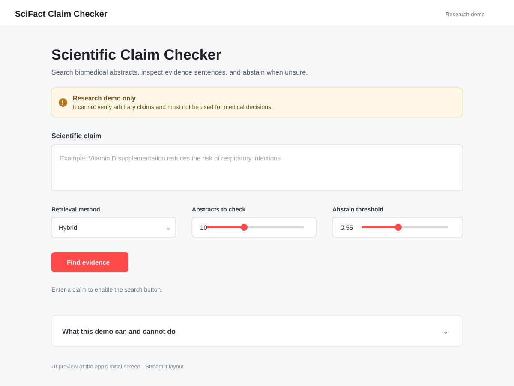

# SciFact Scientific Claim Checker



*Static preview of the app's initial Streamlit screen.*


A research demo for checking biomedical claims against the SciFact abstract collection. It retrieves candidate abstracts with BM25, dense sentence embeddings, or hybrid rank fusion, then compares the claim with abstract sentences using a pretrained natural language inference model. If evidence scores do not clear the selected threshold, it abstains.

This is a small benchmark prototype, not a general-purpose fact checker and not medical advice.

## What it does

- Searches the 5,183-abstract SciFact corpus.
- Shows sentence-level evidence with a source title and document ID.
- Returns support, contradiction, mixed evidence, or not enough evidence.
- Compares BM25, dense, and hybrid retrieval and tunes an abstention threshold on the labeled dev split.

## Run locally

Python 3.10 or newer is recommended. The first run downloads the SciFact archive and two Hugging Face models; model downloads may take a while and CPU inference can be slow.

```bash
python -m venv .venv
# Windows: .venv\Scripts\activate
# macOS/Linux: source .venv/bin/activate
pip install -r requirements.txt
streamlit run app.py
```

The downloaded models are cached after the first run.

## Evaluate retrieval and abstention

Run the full labeled dev split:

```bash
python evaluate.py
```

For a faster first run, use `python evaluate.py --limit 40`. The script writes `reports/ablation.csv`. The app uses a method-specific tuned threshold from that file as its slider default.

The reported macro-F1 uses the same dev examples used to select each threshold, so it is a development result rather than an unbiased test score. SciFact test labels are not public.

## Data and limitations

SciFact is a biomedical benchmark with expert-written claims and evidence annotations. The dataset is licensed CC BY-NC 2.0, so review the terms before reuse, especially for commercial use. Claims were constructed from citation contexts; results may not transfer to arbitrary claims or the wider research literature.

The NLI model was pretrained on SNLI and MultiNLI, not biomedical verification. Its scores are not calibrated probabilities. The app can miss study quality, population differences, conflicting findings, and evidence outside this small corpus. It is a research demo, not health advice. Inspect the cited abstract and consult qualified sources for health decisions.

## Sources

- Wadden et al., [Fact or Fiction: Verifying Scientific Claims](https://arxiv.org/abs/2004.14974), EMNLP 2020.
- [SciFact dataset card and license](https://huggingface.co/datasets/allenai/scifact).
- [Original dataset repository and schema](https://github.com/allenai/scifact).
- NLI model: [cross-encoder/nli-deberta-v3-base](https://huggingface.co/cross-encoder/nli-deberta-v3-base).
- Embedding model: [sentence-transformers/all-MiniLM-L6-v2](https://huggingface.co/sentence-transformers/all-MiniLM-L6-v2).
